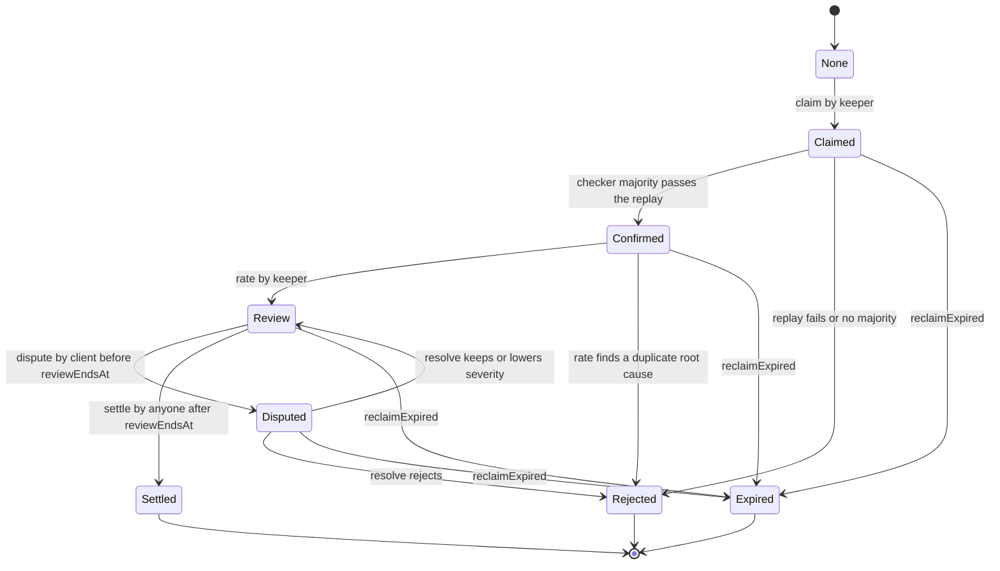

# Sapper contracts

[](https://github.com/sapper-agents/sapper-contracts/actions/workflows/ci.yml) [](LICENSE)

Sapper pays a bounty only for an exploit that staked checkers have replayed and confirmed. These contracts hold each client's bounty pot, run the checker vote on every finding, and settle the bounty once a confirmed finding has been rated and its review period has passed.

The contracts are written in Solidity 0.8.24 against OpenZeppelin 5.4 and are not upgradeable. They target Robinhood Chain (chain id 4663) with USDG, a six-decimal stablecoin, as the bounty and stake token.

## Deployed on Robinhood Chain

Chain id 4663, deployed at block 117,622,458. Source for every contract is verified on Sourcify.

| Contract | Address | Verified source |
|---|---|---|
| `SapperScope` | [`0xc184d4Cd3fc4E5cb28B3F9CBb8EC937DdF11f7a8`](https://robinhoodchain.blockscout.com/address/0xc184d4Cd3fc4E5cb28B3F9CBb8EC937DdF11f7a8) | [source](https://repo.sourcify.dev/4663/0xc184d4Cd3fc4E5cb28B3F9CBb8EC937DdF11f7a8) |
| `SapperBountyPot` | [`0x5fB319FCdfD2c9f5891f09e56E7d2Df25dDEf8C9`](https://robinhoodchain.blockscout.com/address/0x5fB319FCdfD2c9f5891f09e56E7d2Df25dDEf8C9) | [source](https://repo.sourcify.dev/4663/0x5fB319FCdfD2c9f5891f09e56E7d2Df25dDEf8C9) |
| `SapperSettlementGate` | [`0x7ceD074965FA93Ad2294bF7aD512b04A3B4F1EaF`](https://robinhoodchain.blockscout.com/address/0x7ceD074965FA93Ad2294bF7aD512b04A3B4F1EaF) | [source](https://repo.sourcify.dev/4663/0x7ceD074965FA93Ad2294bF7aD512b04A3B4F1EaF) |
| `SapperCheckerNet` | [`0x1107C4EfeD27CB8fd18f24dcC76Fd2d0A70175bb`](https://robinhoodchain.blockscout.com/address/0x1107C4EfeD27CB8fd18f24dcC76Fd2d0A70175bb) | [source](https://repo.sourcify.dev/4663/0x1107C4EfeD27CB8fd18f24dcC76Fd2d0A70175bb) |
| `SapperReceiptLog` | [`0x7612455813e91358923Ab969655f326E59078612`](https://robinhoodchain.blockscout.com/address/0x7612455813e91358923Ab969655f326E59078612) | [source](https://repo.sourcify.dev/4663/0x7612455813e91358923Ab969655f326E59078612) |
| `SapperValidationRegistry` | [`0xa302109Eb20bC5cAaF334eDB50F691272E616947`](https://robinhoodchain.blockscout.com/address/0xa302109Eb20bC5cAaF334eDB50F691272E616947) | [source](https://repo.sourcify.dev/4663/0xa302109Eb20bC5cAaF334eDB50F691272E616947) |
| `SapperBurnBuffer` | [`0x79079820BBB57b28A4230267ebE4d04DBE971349`](https://robinhoodchain.blockscout.com/address/0x79079820BBB57b28A4230267ebE4d04DBE971349) | [source](https://repo.sourcify.dev/4663/0x79079820BBB57b28A4230267ebE4d04DBE971349) |

Current settings: review window 72 hours, rating window 7 days, settlement grace 14 days, minimum checker stake 0.05 USDG. The full record is in [`deployments/4663.json`](deployments/4663.json).

## Contracts

| Contract | Responsibility |
|---|---|
| `SapperScope` | Opt-in registry. A client proves control of a target contract once: the target's `owner()`, `admin()` or `DEFAULT_ADMIN_ROLE` holder opts in directly or signs an EIP-712 message (EOA or ERC-1271). Targets on other chains opt in with a signature from the control attester. Each entry stores the invariants root and the disclosure address. Holds no funds. |
| `SapperBountyPot` | The only contract that holds bounty tokens. Keeps every client's unlocked and locked balance, a price table per client, one lock per finding, and the earnings owed to each payee. |
| `SapperSettlementGate` | The finding lifecycle. The only caller of the pot's lock functions and of the checker net's `openRound`. Records severity, root cause, the worker split and disputes, and posts an ERC-8004 validation response when a finding settles. |
| `SapperCheckerNet` | Staked checkers. Draws 3 to 5 checkers per finding, excluding the breaker that reported it, and runs a commit and reveal vote on `(passed, resultHash)`. A strict majority of the assigned checkers decides. |
| `SapperBurnBuffer` | Receives the 5% burn share as pot earnings and holds it until a buy-and-burn path exists. |
| `SapperValidationRegistry` | Minimal ERC-8004 validation registry bound to an existing identity registry. |
| `SapperReceiptLog` | Write-once log of one Merkle root of step receipts per scan job. |

## Finding lifecycle



`SapperSettlementGate.Status` encodes these states as `None = 0` through `Expired = 7` in the order `None, Claimed, Confirmed, Review, Disputed, Settled, Rejected, Expired`.

What each transition does to the finding's lock in the pot:

| Transition | Lock |
|---|---|
| `claim` | Locks `min(table.crit, unlocked)` for the target's client and freezes the client's table into the lock. Expires at `now + ratingWindow`. |
| Replay fails or no majority | Released in full to the client's unlocked balance in the same transaction. |
| `rate` | Reduced to `min(price(terms, severity), current lock)`. The difference returns to the client. Expiry moves to `reviewEndsAt + settleGrace`. |
| `rate`, duplicate root cause | Released in full. |
| `resolve`, lower severity | Reduced to `min(price(terms, finalSeverity), current lock)`. |
| `resolve`, reject | Released in full. The root cause becomes available to a later finding. |
| `settle` | Credited to the payees as earnings. |
| `reclaimExpired` | Returned to the client's unlocked balance. |

A finding is a duplicate when an earlier finding with the same client, target, chain id and root cause hash was rated and has not been rejected through a dispute.

## Money flow

1. **Fund.** A client calls `fund(amount)` after an ERC-20 approval, or `fundWithPermit` with an EIP-2612 signature. The amount joins the client's unlocked balance.
2. **Price.** `setTable(crit, high, med, low)` sets the client's prices in token units. Without a custom table the defaults are 10,000, 2,500, 500 and 0 USDG.
3. **Provisional lock.** When the keeper claims a finding, the gate locks the client's Critical price, capped by the unlocked balance at that moment. A client cannot withdraw a locked amount, so funds cannot leave between claim and rating. Claims lock in the order they arrive.
4. **Replay.** The drawn checkers commit, then reveal. Anyone can call `finalize` once every checker has revealed or the reveal window has closed. A failed or undecided replay releases the lock immediately.
5. **Rate.** The keeper sets severity, root cause and the worker split. The lock can only go down: it is priced against the table frozen at claim, never re-reads the unlocked balance, and the excess returns to the client at once. Rating opens a review period of `reviewWindow` (72 hours by default).
6. **Review.** During the review period the client can dispute. The dispute resolver then rejects the finding, keeps its severity or lowers it.
7. **Settle.** After the review period, and before the lock expires, anyone can call `settle`. The pot makes no transfers here. It credits earnings:
   - 80% to the workers, split by their basis points;
   - 5% shared equally by the checkers that formed the majority;
   - 5% to the burn buffer;
   - 10% to the treasury, plus every rounding remainder, so the credits sum exactly to the lock.

   A 10,000 USDG lock with a 70/30 worker split and three consensus checkers credits 5,600 and 2,400 to the workers, 166.666666 to each checker, 500 to the burn buffer and 1,000.000002 to the treasury.
8. **Withdraw earnings.** Each payee calls `withdrawEarnings(amount)` for its own credit, paid to its own address. The burn buffer's owner calls `collect(pot)` to pull the buffer's credit.
9. **Reclaim.** Once a lock passes its expiry, anyone can call `reclaimExpired` and the amount returns to the client. An unrated claim expires `ratingWindow` (7 days by default) after the claim. A rated finding that is never settled expires `settleGrace` (14 days by default) after the review period set at rating.

A client can call `withdraw(amount)` on its unlocked balance at any time.

At every point the pot's token balance equals the sum of all clients' unlocked and locked balances plus all unwithdrawn earnings. Tokens leave the pot only through `withdraw` and `withdrawEarnings`.

## Guarantees

| Guarantee | Mechanism | Tests |
|---|---|---|
| A client's unlocked balance is always withdrawable. | `withdraw` has no pause, no external call other than the token transfer, and no dependency on the gate. | `testFuzz_unlockedWithdrawAlwaysSucceeds` (claims paused, locks open), `testFuzz_withdrawWhileOtherFindingsLocked` |
| An expired lock always refunds. | `reclaimExpired` books the refund before notifying the gate and ignores a failing gate. A lock past its expiry cannot be repriced or extended, so a late rating cannot hold it. | `test_reclaimSurvivesFailingGate`, `test_expiredLockRefundsByAnyoneAndCannotSettle`, `test_unratedClaimRefundsAfterRatingWindow`, `test_unresolvedDisputeExpiresToClient`, `test_expiredLockCannotBeAdjusted` |
| A failed replay leaves the client exactly whole. | Consensus failure releases the full provisional lock in the same transaction. | `testFuzz_failedReplayLeavesClientWhole` (failed, split and silent rounds), `test_failedReplayNeverLocksOrPays` |
| Rating and dispute resolution only lower a lock. | `adjustLock` takes `min(price, current lock)` against the claim-time table. | `test_rateNeverRaisesProvisionalLock`, `test_rateLowersLockToSeverityPrice`, `test_tableChangeAfterClaimDoesNotReprice`, `test_disputeReRatesDownAgainstFrozenTable`, `test_adjustLockReturnsDifference` |
| The split is exact. | Integer shares with every remainder credited to the treasury. | `testFuzz_settleSplitsExactly`, `test_settleExactBpsOnRoundAmount` |
| No payee can block a settlement. | `settle` only credits a ledger. A frozen, blocklisted or rejecting payee withdraws later, and its credit stays intact until then. | `test_settleNeverBlockedByFrozenOrRejectingPayee`, `test_settleCreditsFrozenPayeesWhoWithdrawLater` |
| A payee cannot take more than it was credited. | `withdrawEarnings` reverts above `earningsOf(msg.sender)`. | `testFuzz_withdrawEarningsNeverExceedsCredit` |
| Conservation. | Balance equals client balances plus earnings, checked after every call of random fund, claim, consensus, rate, dispute, resolve, settle, withdraw and reclaim sequences on the full contract set, and on the pot alone. | `SapperSettlementInvariantTest`, `SapperBountyPotInvariantTest` |
| A refunded claim never blocks its checker round. | The gate accepts a consensus for a finding that already expired, so the round finalizes, checkers are released and slashing still applies. | `test_roundStillFinalizesAfterClaimRefunded` |
| The breaker never checks its own finding. | The breaker operator is excluded from the draw. | `testFuzz_breakerOperatorNeverDrawn`, `test_breakerOperatorIsExcludedFromItsRound` |
| A validation post never blocks a payout. | A refused ERC-8004 request is recorded as skipped. | `test_validationRefusalNeverBlocksSettle` |
| Only a target's controller can put it in scope. | Control is read from the target or proven by the controller's signature. | `testFuzz_optIn_rejectsStranger`, `test_optIn_signatureMustComeFromController`, `test_remote_attesterCannotBeSkippedWithOwnerEcho` |

## Roles

Each contract except the validation registry has its own `Ownable2Step` owner. Ownership moves only when the proposed owner accepts it.

### Owner

Can:
- appoint the keeper, the guardian and the dispute resolver on the gate;
- set `ratingWindow` (up to 30 days), `reviewWindow` (up to 30 days), `settleGrace` (up to 60 days) and the validation base URI on the gate;
- pause and unpause new claims;
- set the treasury and burn buffer addresses that future settlements credit;
- set the checker net's treasury for slashed stake, the minimum stake, the unstake cooldown (up to 30 days) and the commit and reveal windows (up to 1 day each);
- set the control attester on the scope;
- collect and release the burn buffer's tokens.

Cannot:
- move or lock a client's balance;
- change an existing lock, its expiry or its terms;
- move or reassign earnings already credited;
- pause or gate `withdraw`, `withdrawEarnings` or `reclaimExpired`;
- replace the gate on the pot or the checker net once it is set, or upgrade any contract.

Window changes apply to later claims and ratings. Expiries already written into locks do not move.

### Keeper

Can:
- claim a finding on an in-scope target, which opens the checker round and takes the provisional lock;
- rate a confirmed finding: severity, root cause and a worker split of up to 16 workers whose basis points sum to 10,000;
- anchor receipt roots in the receipt log.

Cannot:
- lock more than the client's Critical price, or more than the client's unlocked balance at claim;
- raise a lock when rating, or rate once the lock has expired;
- bring a settlement forward: for every caller, settlement waits for the review period and is blocked while a dispute is open;
- claim while claims are paused or for a target that is not in scope;
- touch withdrawals, earnings or refunds.

The keeper chooses the severity and the worker split within these limits. The client's recourse is a dispute during the review period.

### Guardian

Can pause and unpause new claims. Nothing else: open findings continue, settlements and refunds proceed, and every withdrawal stays available while claims are paused.

### Dispute resolver

Can, on a disputed finding only: reject it, which releases the full lock and frees the root cause; keep its severity; or lower it, priced against the claim-time table and capped by the current lock.

Cannot raise severity or act on a finding that is not disputed. Lowering requires an unexpired lock. Once the lock expires, the amount returns to the client through `reclaimExpired`.

### Clients, checkers and anyone

- A **client** funds its pot, sets its table, withdraws its unlocked balance, opts targets in and out, and disputes a rated finding during its review period.
- A **checker** stakes, commits and reveals. A checker that votes against the majority or fails to reveal loses 10% of its stake to the checker net's treasury, and three strikes remove it from the pool. Stake can be withdrawn after the cooldown and only while the checker has no open round.
- **Anyone** can call `finalize`, `settle` and `reclaimExpired` once their conditions hold.

## Known properties

- **Checker draw.** The draw seed is `keccak256(findingId, blockhash(block.number - 1))`; `prevrandao` is constant on Arbitrum Orbit chains. The sequencer can bias the seed, and the keeper can too, because it picks the finding id it claims with. Sapper operates every checker today, so this bias cannot hand a finding to an outside party. Before outside checkers join, selection moves to a commit-based scheme in which the draw depends on a value committed before the finding id is known.
- **Concurrent claims share one pot.** Each claim locks against the unlocked balance at its own claim time, so a claim made while earlier claims hold the balance can lock less, or nothing. Rating never tops a lock up. A confirmed finding with an empty lock settles as confirmed and unpaid.
- **Frozen payees.** Earnings are paid only to the payee's own address. If the token issuer freezes that address, its credit stays in the pot until the freeze lifts; other payees are unaffected.
- **Direct transfers.** Tokens sent to the pot without `fund` are credited to no one and cannot be recovered. The balance then exceeds the tracked total by that amount.
- **Owner reach.** The owner cannot move funds, but it appoints the keeper and the dispute resolver, who decide ratings and dispute outcomes within the limits above.
- **Rating window sizing.** `ratingWindow` should exceed a full checker round (commit plus reveal, at most two days) plus the time needed to rate. A claim that is not rated in time refunds to the client.
- **Slashed stake.** `finalize` transfers slashed stake to the checker net's treasury. If the token freezes that address, rounds with a slash cannot finalize until the owner sets a new treasury.
- **Validation posts.** The gate posts an ERC-8004 response only when the agent's owner has approved the gate as an operator on the identity registry. Without approval the post is skipped and the settlement completes.

## Build and test

Requires [Foundry](https://book.getfoundry.sh). Dependencies are pinned through Soldeer.

```sh
forge soldeer install
forge build
forge test
```

Fuzz tests run 1,000 cases and invariant tests run 256 sequences of 64 calls, as set in `foundry.toml`. The fork tests in `test/fork` run against Robinhood Chain when `RH_RPC_URL` is set and are skipped otherwise:

```sh
RH_RPC_URL=<rpc url> forge test --match-path "test/fork/*"
```

## Deployment

`script/Deploy.s.sol` deploys all seven contracts, connects the pot and the checker net to the gate, applies optional settings, offers ownership to `OWNER` when it is set, and writes the addresses and settings to `deployments/<chainId>.json`.

```sh
forge script script/Deploy.s.sol --rpc-url <rpc url> --broadcast <signer flags>
```

| Variable | Required | Default | Meaning |
|---|---|---|---|
| `USDG` | yes | | Bounty token held by the pot. |
| `TREASURY` | yes | | Credited 10% of each settlement; receives slashed checker stake. |
| `KEEPER` | yes | | Gate keeper and receipt log keeper. |
| `GUARDIAN` | yes | | May pause and unpause new claims. |
| `RESOLVER` | yes | | Dispute resolver. |
| `IDENTITY_REGISTRY` | yes | | ERC-8004 identity registry the validation registry reads. |
| `CONTROL_ATTESTER` | no | zero address | Signer for opt-ins of targets on other chains. Zero disables them. |
| `STAKE_TOKEN` | no | `USDG` | Checker stake token. |
| `MIN_STAKE` | no | `100000000` (100 USDG) | Minimum free stake to be drawn, in token units. |
| `RATING_WINDOW` | no | 7 days | Seconds a provisional lock lasts before rating, at most 30 days. |
| `OWNER` | no | deployer | Receives a two-step ownership offer for the six owned contracts. |

On Robinhood Chain, USDG is `0x5fc5360D0400a0Fd4f2af552ADD042D716F1d168` and the ERC-8004 identity registry is `0x8004A169FB4a3325136EB29fA0ceB6D2e539a432`.

After deployment:
- `OWNER` calls `acceptOwnership()` on `SapperScope`, `SapperBurnBuffer`, `SapperBountyPot`, `SapperCheckerNet`, `SapperSettlementGate` and `SapperReceiptLog`;
- the owner of each breaker agent identity calls `setApprovalForAll(gate, true)` on the identity registry so settlements post validation responses.

## Related

- [sapper-replay](https://github.com/sapper-agents/sapper-replay): the reproduction format and replay engine checkers run before they vote.
- [sapperagents.com](https://sapperagents.com)

## Security

Report vulnerabilities privately through **Report a vulnerability** on this repository or hello@sapperagents.com. See the [security policy](https://github.com/sapper-agents/.github/blob/main/SECURITY.md). These contracts have not been audited.

## License

MIT. See [LICENSE](LICENSE).
